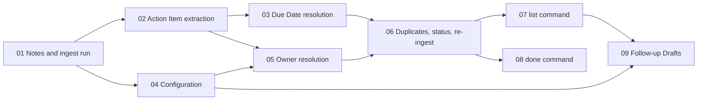

# Spec index: dependencies and parallel work

Which specs can be built at the same time, and which files they collide on. The source of truth for blockers is each spec's `Blocked by:` line, and for progress its `Status:` line. This page does not copy statuses, so it never goes stale.

**Live frontier.** Each spec's status and blockers:

```bash
grep -H -m2 -E '^(Status|Blocked by):' docs/specs/0*.md
```

A spec is ready when its `Status` is `ready-for-agent` and every spec in its `Blocked by` is `done` on `main`. A spec is taken when a `feat/NN-*` branch exists for it (see step 2 below).

## Dependency graph



**Critical path:** 01 → 02 → 03 or 05 → 06 → 07 → 09 (six waves). Running specs in parallel saves sessions, not waves.

## Waves

Specs in the same wave have no dependency on each other and can run in parallel sessions once the previous wave is merged.

| Wave | Spec | Blocked by | Requirements | Parallel with | Collision risk |
|---|---|---|---|---|---|
| 1 | [01 Notes and ingest run](01-notes-and-ingest-run.md) | none | FR-1, FR-2, FR-3, FR-12, NFR-2–4, NFR-6–8 | none | none |
| 2 | [02 Action Item extraction](02-action-item-extraction.md) | 01 | FR-4, FR-5, FR-6, FR-10, FR-11, FR-13 (basic) | 04 | Low. 02 adds the items/sources schema; 04 adds `config.py` and `--config` loading. Both touch `cli.py`. |
| 2 | [04 Configuration](04-configuration.md) | 01 | FR-18, FR-7 (roster), NFR-1, NFR-4 | 02, 03 | |
| 3 | [03 Due Date resolution](03-due-date-resolution.md) | 02 | FR-8, FR-12 (unresolved Due Phrases), NFR-3 | 05, 04 | **High.** Both add a schema migration and fill report keys in `ingest.py`. |
| 3 | [05 Owner resolution](05-owner-resolution.md) | 02, 04 | FR-7, FR-12 (owner sections), FR-13 (owner column) | 03 | |
| 4 | [06 Duplicates, status, re-ingest](06-duplicates-status-and-reingest.md) | 03, 05 | FR-9, FR-10, FR-11, FR-12 (merge/done counts) | none | none |
| 5 | [07 `list` command](07-list-command.md) | 06 | FR-13, NFR-3, NFR-6 | 08 | Low. Both add a subcommand to `cli.py` and queries to `store.py`. |
| 5 | [08 `done` command](08-done-command.md) | 06 | FR-14, FR-10, FR-11 | 07, 09 | |
| 6 | [09 Follow-up Drafts](09-followup-drafts.md) | 04, 07 | FR-15, FR-16, FR-17, NFR-1, NFR-4, NFR-5, ADR-0001 | 08 | Low. Adds `gmail.py`, `followup.py`, the drafts table and the `mcp` dependency. |

Most parallelism: **2 sessions** in waves 2, 3 and 5. Spec 04 only needs 01, so it can also overlap wave 3's spec 03 if it lags.

## Running parallel sessions

1. **One worktree and branch per spec**, based on the branch that already contains all of its blockers (usually `main` after the previous wave merged):
   ```bash
   git worktree add ../at-02 -b feat/02-action-item-extraction main
   ```
2. **The branch is the claim.** Worktrees share one repository, so every session sees every branch. Before picking a ready spec, check that nobody has a branch for it:
   ```bash
   git branch --list 'feat/0*'
   ```
3. **Merge in wave order.** Rebase or merge the second branch of a wave onto `main` after the first lands, then run `pytest` before merging.
4. Set `Status: done` when the spec's tests pass, as `CLAUDE.md` says.

### Shared hotspots

These files are touched by almost every spec. Expect small conflicts there, and resolve them as described:

| File | Conflict | Resolution |
|---|---|---|
| `src/actiontrack/store.py` `_MIGRATIONS` | Two specs each append a migration (03 and 05). | Migrations are append-only. The branch merged second moves its entry after the first's, so it becomes the next `user_version`. Never edit a merged migration. |
| `src/actiontrack/ingest.py` `IngestReport` | Specs fill different report keys. | Keep both. Report keys are add-only (NFR-6). |
| `src/actiontrack/cli.py` `_build_parser` | 07 and 08 each add a subcommand. | Keep both subparsers. |
| `tests/conftest.py` | Harness helpers added by several specs. | Keep both helpers. Don't change the existing helpers' signatures. |
| `docs/frd.md`, `GLOSSARY.md` | Behaviour notes per spec. | Keep both; ids are stable. |
