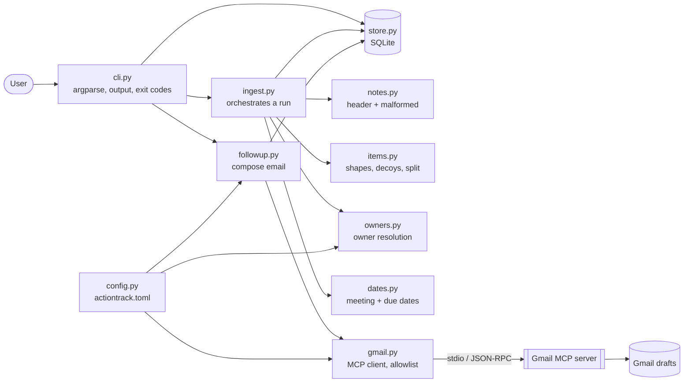
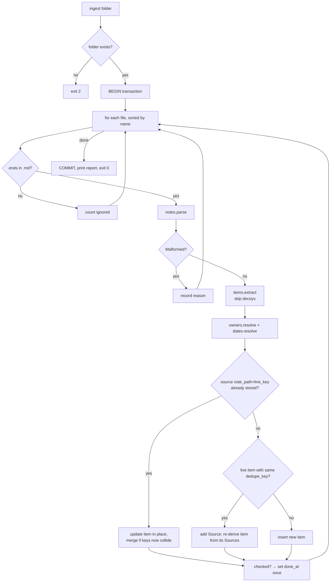
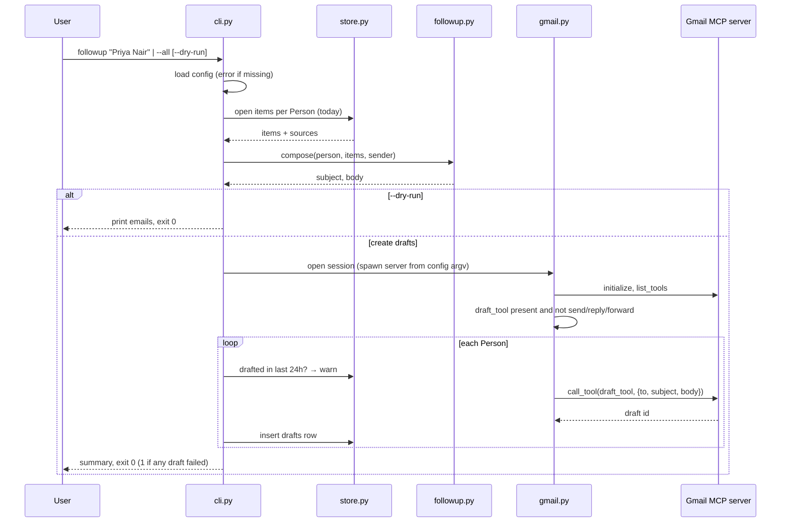

# actiontrack — Technical Details

How actiontrack is built. Behaviour is specified in [`frd.md`](frd.md) (`FR-<n>`), qualities in [`nfrd.md`](nfrd.md) (`NFR-<n>`), terms in [`../GLOSSARY.md`](../GLOSSARY.md), and decisions in [`adr/`](adr/). This document covers the *how*: stack, modules, data model, flows, testing and setup.

---

## 1. Stack

| Concern | Choice | Why |
|---|---|---|
| Language | Python 3.11+ | `tomllib` is in the stdlib from 3.11; good date and regex support. |
| CLI | `argparse` | stdlib; subcommands and `--help` for free. |
| Storage | SQLite via `sqlite3` | One local file, transactions (NFR-2), no server. |
| Config | TOML via `tomllib` | stdlib, readable, supports arrays of tables for the roster. |
| Gmail | Official `mcp` Python SDK, stdio client | actiontrack is its own MCP client ([ADR-0001](adr/0001-followup-drafts-via-own-mcp-client.md)). This is the only runtime dependency (NFR-7). |
| Tests | `pytest` (dev only) | Includes a fake Gmail MCP server built with the same SDK. |

No other runtime dependencies. Date phrases are resolved by our own rules (FR-8), not a natural-language date library, so results are deterministic (NFR-3).

---

## 2. Architecture



**Layering rule (NFR-9):** `notes`, `items`, `owners`, `dates` and `followup` are pure: no I/O beyond what's passed in, no SQLite, no MCP. Only `store.py` knows SQL, and only `gmail.py` knows MCP. This keeps every rule unit-testable without a database or network.

### Package layout

```
Action-Tracker/
├── pyproject.toml            # console script: actiontrack = actiontrack.cli:main
├── actiontrack.toml          # local config (not committed; see actiontrack.example.toml)
├── src/actiontrack/
│   ├── cli.py
│   ├── config.py
│   ├── notes.py
│   ├── items.py
│   ├── owners.py
│   ├── dates.py
│   ├── ingest.py
│   ├── store.py
│   ├── followup.py
│   └── gmail.py
├── tests/
│   ├── fake_gmail_server.py
│   └── test_*.py
└── notes/                    # sample fixture, read-only
```

### Module responsibilities

| Module | Owns | Requirements |
|---|---|---|
| `cli.py` | Subcommands, global options (`--db`, `--config`, hidden `--today`), table vs `--json` output, stdout/stderr split, exit codes | FR-12–15, NFR-6 |
| `config.py` | Find and load `actiontrack.toml`; validate `[gmail]` and `[[people]]`; reject a send/reply/forward tool name | FR-18, NFR-1 |
| `notes.py` | Read bytes → UTF-8 text; parse the `# Meeting:`/`Date:`/`Attendees:` or YAML front-matter header; return a `Note` or a `Malformed(reason)` | FR-1–3 |
| `items.py` | Walk the note body; skip blockquotes and code fences; recognise checkbox, `@name:`, table and `ACTION:` shapes; split owner part / task / Due Phrase; build the normalised dedupe text | FR-4–6, FR-9 |
| `owners.py` | Resolve an owner part against Attendees, then the roster → Person(s), Team, Ambiguous, Unknown or Unassigned | FR-7 |
| `dates.py` | Parse the Meeting Date; resolve a Due Phrase against it using the FR-8 table | FR-2, FR-8 |
| `ingest.py` | Run the folder: for each file, parse → extract → resolve → upsert, collecting the report. One transaction per run | FR-1, FR-9–12, NFR-2 |
| `store.py` | Schema, migrations (`PRAGMA user_version`), upserts, merges, queries for list/done/followup, draft history | FR-9–11, FR-13–15 |
| `followup.py` | Pick a Person's Open items, order them, render subject and plain-text body | FR-15–16 |
| `gmail.py` | Start the configured stdio MCP server, `initialize`, confirm the draft tool exists, `call_tool(draft_tool, …)` once per draft | FR-17, NFR-1 |

---

## 3. Data model

Persons are identified by full name (as written in Attendees or the roster). There is no Person table: known Persons are the distinct Attendees across ingested notes plus the roster.

```sql
-- PRAGMA user_version = 5 (the schema after all migrations in store.py)
CREATE TABLE notes (
  path          TEXT PRIMARY KEY,          -- absolute path
  title         TEXT NOT NULL,
  meeting_date  TEXT NOT NULL,             -- ISO yyyy-mm-dd
  attendees     TEXT NOT NULL,             -- JSON array of full names
  ingested_at   TEXT NOT NULL
);

CREATE TABLE items (
  id            INTEGER PRIMARY KEY,       -- stable, never reused (FR-11)
  task          TEXT NOT NULL,             -- derived: task text from the latest Source
  dedupe_key    TEXT,                      -- owners + normalised task (FR-9); NULL only for rows from before spec 06, set on their next ingest
  owner_kind    TEXT NOT NULL CHECK (owner_kind IN
                  ('person','team','ambiguous','unknown','unassigned')),
  written_owner TEXT,                      -- as written, e.g. 'Priya'
  candidates    TEXT,                      -- JSON array, Ambiguous only
  due_phrase    TEXT,                      -- derived: from the latest Source that has one
  due_date      TEXT,                      -- ISO or NULL
  done_at       TEXT,                      -- NULL = Open; set once, never cleared
  done_by       TEXT CHECK (done_by IN ('note','cli')),
  merged_into   INTEGER REFERENCES items(id)
);
CREATE UNIQUE INDEX items_live_key ON items(dedupe_key) WHERE merged_into IS NULL;

CREATE TABLE item_owners (                 -- one row per Owner; many for shared/Team items
  item_id  INTEGER NOT NULL REFERENCES items(id),
  person   TEXT    NOT NULL,
  PRIMARY KEY (item_id, person)
);

CREATE TABLE sources (                     -- one row per occurrence in a note
  note_path TEXT    NOT NULL REFERENCES notes(path),
  line_key  TEXT    NOT NULL,              -- normalised line text
  item_id   INTEGER NOT NULL REFERENCES items(id),
  line_no   INTEGER NOT NULL,
  raw_line  TEXT    NOT NULL,
  checked   INTEGER NOT NULL,              -- 1 if [x]/[X]
  task          TEXT,                      -- what this line said; the item's fields are derived
  written_owner TEXT,                      --   from its Sources (FR-9): task and owner from the latest,
  due_phrase    TEXT,                      --   Due Phrase and Due Date from the latest that has a Due Phrase
  due_date      TEXT,
  PRIMARY KEY (note_path, line_key)        -- re-ingest idempotency (FR-11)
);

CREATE TABLE drafts (                      -- follow-up history (FR-15)
  id             INTEGER PRIMARY KEY,
  person         TEXT NOT NULL,
  email          TEXT NOT NULL,
  gmail_draft_id TEXT,
  item_ids       TEXT NOT NULL,            -- JSON array
  created_at     TEXT NOT NULL
);
```

**Derived, not stored:** Overdue is `done_at IS NULL AND due_date < :today`, computed at query time (FR-13).

**Dedupe key** = `owner_kind` + sorted owner names (or the written name for Ambiguous/Unknown, empty for Unassigned) + `|` + the task lowercased, without punctuation, without `a`/`an`/`the`, and without the Due Phrase.
Example: both `Priya to send the revised quote to Acme by Friday` and `Priya N. to send revised quote to Acme — by Friday` → `person:Priya Nair|send revised quote to acme`.

---

## 4. Flows

### 4.1 Ingest



- Files are processed in name order so that ids are deterministic (NFR-3).
- Any exception while parsing a single note is caught in `ingest.py` and becomes a Malformed entry (NFR-2). Exceptions from `store.py` abort the run and roll back the transaction.
- Merge: the higher id gets `merged_into = lower id`, and its Sources and owners move to the lower id. Done wins if either item was Done.

### 4.2 Follow-up



`gmail.py` uses `mcp.ClientSession` over `mcp.client.stdio.stdio_client(StdioServerParameters(command=argv[0], args=argv[1:]))`. It is the only async code, wrapped in `asyncio.run` so the rest of the CLI stays synchronous.

### 4.3 Error and exit-code paths

| Situation | Behaviour | Exit |
|---|---|---|
| Malformed Note | Skipped and listed in the report | 0 |
| Unresolved Due Phrase, Ambiguous/Unknown/Unassigned owner | Stored and listed in the report | 0 |
| Folder missing, bad arguments, bad date in `--due-before` | Message on stderr | 2 |
| `done` with an unknown id | Message on stderr | 1 |
| `followup` without config, or Person not found / ambiguous name | Message on stderr | 2 |
| MCP server fails to start or lacks the draft tool | Message on stderr; no drafts | 1 |
| One draft fails during `--all` | Others continue; failures listed | 1 |
| SQLite error during ingest | Roll back; database unchanged | 1 |

---

## 5. Testing

There are exactly two test seams (NFR-5):

1. **CLI entry point.** The `main(argv)` function is called in-process with a temp notes folder, a temp `--db` and a pinned `--today`. Tests assert on the exit code, stdout/stderr and `--json` output only.
2. **Gmail MCP boundary.** `fake_gmail_server.py` stands in for the real server.

Tests are grouped by spec, one file per `docs/specs/NN-*.md`, and each test names the FR/NFR it proves. Rule tables (FR-7, FR-8) are parametrised tests that write a tiny note per row. `test_sample_notes.py` ingests `notes/` with `--today 2026-10-15` and asserts every row of FRD §6.

`fake_gmail_server.py` is a tiny `mcp.server.fastmcp.FastMCP` stdio server. It exposes `create_draft` and a decoy `send_message`, and logs every call to a temp file the test reads.

Run everything with `pytest`. No network or real credentials are needed.

---

## 6. Setup and run

```bash
cd Action-Tracker
python3.11 -m venv .venv && source .venv/bin/activate
pip install -e '.[dev]'
pytest
```

**Configure follow-ups** (only `followup` needs this):

1. Use the stdio Gmail MCP server `@artymclabin/gmail-mcp` (tool `draft_email`; see §6.1) and complete *its* Google OAuth setup.
2. Copy `actiontrack.example.toml` to `actiontrack.toml` and fill in `sender`, `[gmail].command`, `[gmail].draft_tool`, and one `[[people]]` entry per Person with their email.

**Use:**

```bash
actiontrack ingest notes/
actiontrack list                               # open items
actiontrack list --owner "Priya Nair" --status overdue
actiontrack list --due-before 2026-10-01 --json
actiontrack done 12
actiontrack followup "Priya Nair" --dry-run    # preview
actiontrack followup --all                     # creates Gmail drafts, sends nothing
```

### 6.1 Production Gmail MCP server

actiontrack is tested against the stdio server **`@artymclabin/gmail-mcp`** ([source](https://github.com/ArtyMcLabin/Gmail-MCP-Server), MIT, npm 1.2.4 released 2026-11-01). It is the maintained fork of the archived `GongRzhe/Gmail-MCP-Server`.

- **Launch:** `command = ["npx", "-y", "@artymclabin/gmail-mcp"]`, `draft_tool = "draft_email"`.
- **Auth (NFR-4):** owned by the server. Create a Google Cloud OAuth client (Desktop), save its JSON as `~/.gmail-mcp/gcp-oauth.keys.json`, then run `npx @artymclabin/gmail-mcp auth --scopes=gmail.compose` once. Tokens go to `~/.gmail-mcp/credentials.json`; actiontrack never sees them.
- **Arguments:** `draft_email` takes `to`, `subject` and `body` (plain text). **`to` is a list of strings**, not a string, so the client must send `to: ["person@example.com"]`.
- **Result:** plain text, no `structuredContent`: `Email draft created successfully with ID: <id>`. The draft id is the text after `ID: `.
- **Errors:** a failed call comes back as ordinary text starting `Error: ` with `isError` unset, so a draft counts as created only when the success text carries an id.
- **Note:** this server also exposes `send_email`, `send_draft` and `reply_all`; the NFR-1 allowlist in `gmail.py` is what keeps actiontrack from calling them.

---

## 7. Demo walkthrough (sample notes)

Pin today so the demo matches the FRD examples: `export ACTIONTRACK_TODAY=2026-10-15`.

1. **`actiontrack ingest notes/`**: 35 `.md` files are read, 4 are skipped as Malformed (`scratch.md` not text, `2026-09-09-notes-final-v2.md` empty, `untitled.md` no date, `2026-10-03-sales-pipeline.md` unresolvable date), and 1 file (`2026-09-19-offsite-draft.txt`) is ignored. The report lists the Ambiguous Owners (e.g. `Priya` in `2026-10-08-billing-go-no-go.md`, candidates Priya Nair / Priya Shah) and the Unassigned items (`TBD…`, `Someone…`).
2. **Run ingest again**: zero new items and the same ids (FR-11).
3. **`actiontrack list --owner "Priya Nair" --status done`**: shows "send the revised quote to Acme" as one item with three Sources (09-01, 09-08, 09-15), Done from the `[x]` in 09-15.
4. **`actiontrack list --status overdue`**: includes "finalise the Q4 sales targets" (Meera Iyer, due 2026-10-03, 12 days overdue).
5. **`actiontrack list --owner "Anita Desai"`**: includes the shared item "agree on the component API" (also listed under Rahul Mehta) and the Team Item "decide on the launch date".
6. **`actiontrack done <id>`** on an item, then `list` again: it's gone from the open list.
7. **`actiontrack followup --all --dry-run`**: one email per Person with Open items, Overdue first. Ambiguous items such as "circulate the go/no-go summary" don't appear in any email.
8. **`actiontrack followup "Meera Iyer"`**: creates one Gmail draft. Open Gmail → Drafts to review it; nothing has been sent.

The exact item counts and ids are determined by the implementation; the end-to-end test asserts the specific facts above.

---

## 8. Risks and limitations

| Risk | Impact | Mitigation / next step |
|---|---|---|
| The chosen Gmail MCP server (§6.1) takes `to` as a list and reports failures as plain text without `isError` | A string `to` is rejected; a failed draft looks like a normal result | Send `to` as a one-item list; accept a draft only when the result text carries an id |
| Exact-after-normalising dedupe misses heavier rewording | The same commitment shows as two items | Accepted trade-off against false merges; spot-check `list` after ingest |
| Owner-part heuristic (capitalised words before ` to `) | A task starting with a capitalised phrase could be misread as an owner, which then shows as Unknown | Unknown Owners are reported at ingest for a human to check |
| Editing a note line after ingest creates a new occurrence; deleting a note doesn't remove its items | Stale items remain open | Mark them done with `done <id>`; a cleanup command is out of scope |
| A new draft on every run | Drafts can pile up in Gmail | 24-hour warning; the human deletes extras |
| "Today" is the machine's local date | Overdue status can differ across time zones at midnight | Acceptable for a single-user CLI |
| Single-user database | Concurrent runs may conflict | Out of scope (NFR "Not committed") |
| The roster must be maintained by hand | Owners missing from it get no follow-up | Reported by `followup` as skipped |
